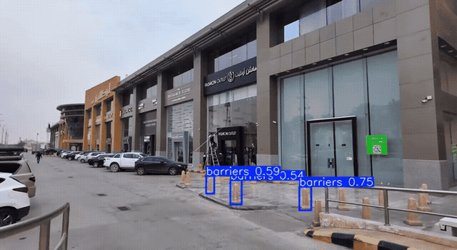
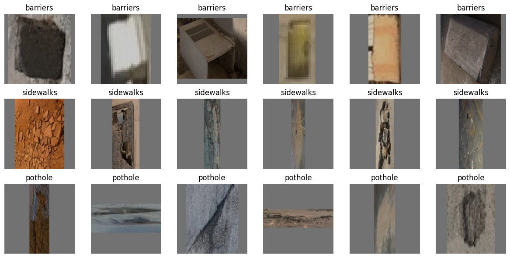
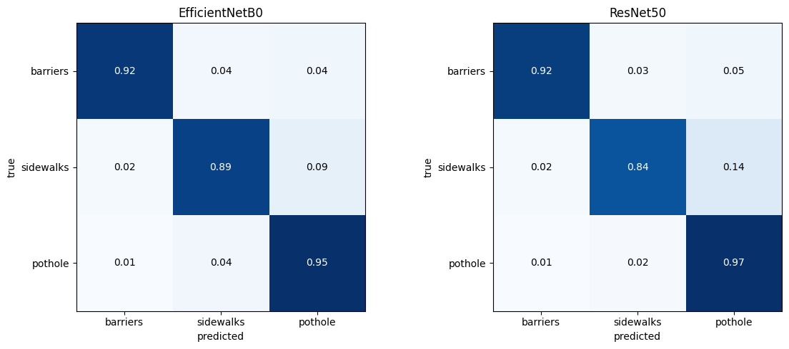
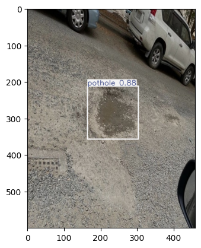

# Saudi Road Damage Detection

<p align="center">
  
</p>

## Idea

Road damage such as potholes, broken sidewalks and damaged barriers is usually
found and reported by hand, which is slow. We use deep learning to recognize and
locate this damage automatically from road photos and videos.

## Solution

| Approach | What it does | Models |
|---|---|---|
| **CNN classification** | Tells the damage type of a cropped image | EfficientNetB0, ResNet50 |
| **YOLO detection** | Finds and boxes the damage in a full photo or video | YOLOv8n |

**Classes:** `barriers` · `sidewalks` · `pothole`

## Dataset

[Saudi Arabia Public Roads Visual Pollution Dataset (Mendeley Data)](https://data.mendeley.com/datasets/bb7b8vtwry/5)

<p align="center">
  
</p>

## What we did

| # | Step | Details |
|---|---|---|
| 1 | **Preprocessing** | Removed duplicate photos, split by report into 70% train / 15% val / 15% test (no leakage), removed boxes with conflicting labels |
| 2 | **Cropping** | Cropped each object, padded it to a square and resized it to 224×224 |
| 3 | **Augmentation** | Flip, small rotation, brightness and contrast; class weights for the class imbalance |
| 4 | **CNN training** | EfficientNetB0 and ResNet50 (ImageNet), trained the head first and then fine-tuned |
| 5 | **YOLO training** | YOLOv8n on the original data and on the cleaned data |
| 6 | **Video testing** | Ran YOLO on road videos from Riyadh (confidence 0.5) |

## Results

| Model | Task | Test result |
|---|---|---|
| EfficientNetB0 | Classification | Accuracy 0.933 · Macro F1 0.914 |
| ResNet50 | Classification | Accuracy 0.939 · Macro F1 0.919 |
| YOLOv8n | Detection | mAP50 0.651 · mAP50-95 0.433 |
| YOLOv8n (cleaned data) | Detection | mAP50 0.651 · mAP50-95 0.424 |

<p align="center">
  
</p>

<p align="center">
  
</p>

## Project structure

```
├── notebooks/
│   ├── data_preparation.ipynb
│   ├── cnn/             cnn_classification
│   ├── yolo/            yolo_training, yolo_video_testing
│   └── yolo_cleaned/    yolo_training_cleaned
├── models/              cnn/, yolo/, yolo_cleaned/
├── videos/              input + annotated videos
└── assets/              images for this README
```

The notebooks were run on Kaggle.
